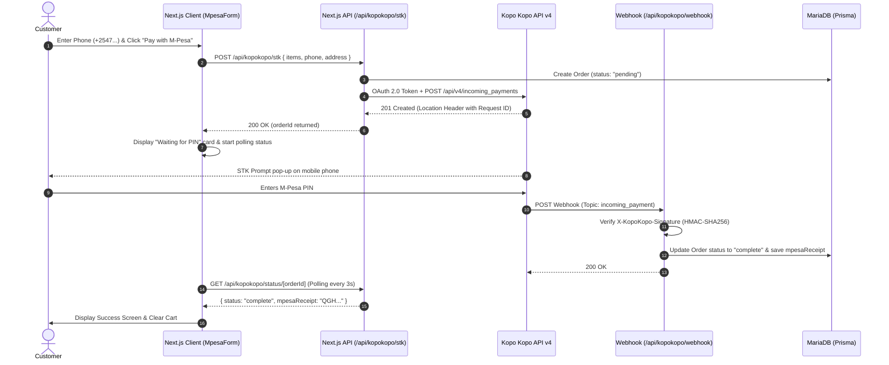

# Kopo Kopo Payment Gateway Integration (Kenya M-Pesa)

Comprehensive guide for the **Kopo Kopo API v4** integration in this Next.js e-commerce application. This integration provides **M-Pesa STK Push prompts**, **Buy Goods (Till)**, and **Paybill** webhook payment processing.

---

## Table of Contents
1. [Architecture Overview](#architecture-overview)
2. [Prerequisites & Accounts](#prerequisites--accounts)
3. [Environment Configuration](#environment-configuration)
4. [Local Development with ngrok](#local-development-with-ngrok)
5. [Webhook Registration](#webhook-registration)
6. [API Endpoints Reference](#api-endpoints-reference)
7. [Database & Order Lifecycle](#database--order-lifecycle)
8. [Webhook Security & Signature Verification](#webhook-security--signature-verification)
9. [Testing the Sandbox](#testing-the-sandbox)
10. [Production Deployment Checklist](#production-deployment-checklist)

---

## Architecture Overview



---

## Prerequisites & Accounts

1. **Kopo Kopo Developer Sandbox Account**:
   * Portal: [https://sandbox.kopokopo.com](https://sandbox.kopokopo.com)
   * Log in or register an account.
2. **Kopo Kopo Production Account** (when going live):
   * Portal: [https://app.kopokopo.com](https://app.kopokopo.com)
3. **Application Credentials**:
   * Navigate to **Settings > API & Webhooks** or **Applications**.
   * Create an application to get:
     * `Client ID`
     * `Client Secret`
     * `API Key`
     * `Till Number`

---

## Environment Configuration

Create or update your `.env` file in the project root:

```env
# ==============================================================
# KOPO KOPO CREDENTIALS
# ==============================================================
# Use https://sandbox.kopokopo.com for testing, https://api.kopokopo.com for production
KOPOKOPO_BASE_URL="https://sandbox.kopokopo.com"
KOPOKOPO_CLIENT_ID="your_client_id_here"
KOPOKOPO_CLIENT_SECRET="your_client_secret_here"
KOPOKOPO_API_KEY="your_api_key_here"
KOPOKOPO_WEBHOOK_SECRET="your_webhook_signing_secret_here"
KOPOKOPO_TILL_NUMBER="K123456"

# ==============================================================
# PUBLIC APP URL (Used for callback URLs)
# During local development, set to your ngrok URL:
# ==============================================================
NEXT_PUBLIC_APP_URL="https://your-ngrok-subdomain.ngrok-free.app"
```

---

## Local Development with ngrok

Because Kopo Kopo servers must deliver HTTP webhooks to your application over the public internet, you need an HTTPS tunnel like **ngrok** during local development.

### 1. Install & Authenticate ngrok
If you haven't already:
```bash
npm install -g ngrok
# or download from https://ngrok.com
```

### 2. Start Next.js Development Server
In your first terminal:
```bash
npm run dev
```

### 3. Start ngrok Tunnel
In a second terminal:
```bash
ngrok http 3000
```
ngrok will display output similar to:
```text
Forwarding   https://abcd-1234-5678.ngrok-free.app -> http://localhost:3000
```

### 4. Update `.env`
Update `NEXT_PUBLIC_APP_URL` in `.env`:
```env
NEXT_PUBLIC_APP_URL="https://abcd-1234-5678.ngrok-free.app"
```
*(Restart your Next.js server so it loads the updated `.env`)*

---

## Webhook Registration

You must register your webhook endpoint in the Kopo Kopo Portal:

1. Log in to [Kopo Kopo Sandbox](https://sandbox.kopokopo.com).
2. Go to **Settings > Webhooks** (or **API Configuration**).
3. Click **Add Webhook** and provide:
   * **Webhook URL**: `https://abcd-1234-5678.ngrok-free.app/api/kopokopo/webhook`
   * **Event Topics to Subscribe**:
     * `Incoming Payments` (triggers upon M-Pesa STK push completion or failure)
     * `Buygoods Transaction Received` (triggers when customer pays directly to Till)
     * `B2b Transaction Received` (optional, for Paybill/B2B transfers)
4. Copy the generated **Webhook Signing Secret** and save it to `.env` as `KOPOKOPO_WEBHOOK_SECRET`.

---

## API Endpoints Reference

### 1. `POST /api/kopokopo/stk`
Triggers an M-Pesa prompt on the user's phone.
* **Headers**: `Content-Type: application/json` (User must be logged in via session)
* **Request Body**:
  ```json
  {
    "items": [
      { "id": "123", "name": "Headphones", "price": 1500, "quantity": 1 }
    ],
    "phoneNumber": "0712345678",
    "address": {
      "city": "Nairobi",
      "line1": "Westlands, Ring Road",
      "postal_code": "00100"
    }
  }
  ```
* **Success Response (200 OK)**:
  ```json
  {
    "success": true,
    "orderId": "6550...",
    "paymentRequestId": "c2b5...",
    "message": "STK push prompt sent. Please check your phone and enter your M-Pesa PIN."
  }
  ```

---

### 2. `POST /api/kopokopo/webhook`
Receives asynchronous payment notifications from Kopo Kopo.
* **Headers**:
  * `X-KopoKopo-Signature`: HMAC-SHA256 signature calculated from the raw payload and `KOPOKOPO_WEBHOOK_SECRET`.
* **Events Handled**:
  * `incoming_payment`: Updates order `status: "complete"` and stores the Safaricom receipt code (`mpesaReceipt`), or marks as `"failed"`.
  * `buygoods_transaction_received`: Matches pending orders by customer phone number and amount.
* **Response**: Returns `200 OK` (`{ "status": "success", "received": true }`).

---

### 3. `GET /api/kopokopo/status/[orderId]`
Used by the frontend to poll payment status.
* **Response (200 OK)**:
  ```json
  {
    "status": "complete",
    "mpesaReceipt": "QGH78XZ19",
    "amount": 1500,
    "currency": "KES"
  }
  ```

---

## Database & Order Lifecycle

The `Order` model in [prisma/schema.prisma](file:///c:/Users/jamie/Desktop/E-commerce/prisma/schema.prisma) contains:

| Field | Type | Description |
|---|---|---|
| `id` | `String` | Primary Key (CUID) |
| `userId` | `String` | Owner of the order |
| `amount` | `Float` | Total order amount in KES |
| `currency` | `String` | `"KES"` |
| `status` | `String` | `"pending"` -> `"complete"` or `"failed"` |
| `deliveryStatus`| `String` | `"pending"`, `"dispatched"`, `"delivered"` |
| `paymentMethod` | `String` | `"kopokopo_stk"` or `"buy_goods"` |
| `phoneNumber` | `String` | Formatted phone number (`+254...`) |
| `mpesaReceipt` | `String` | Safaricom transaction reference (e.g. `QGH789ABCD`) |
| `paymentIntentId`| `String` | Kopo Kopo request ID |

---

## Webhook Security & Signature Verification

Every incoming webhook request is signed by Kopo Kopo using HMAC-SHA256:

$$\text{Signature} = \text{HMAC-SHA256}(\text{rawRequestBody}, \text{KOPOKOPO\_WEBHOOK\_SECRET})$$

In [libs/kopokopo.ts](file:///c:/Users/jamie/Desktop/E-commerce/libs/kopokopo.ts), the `verifyKopoKopoSignature` function uses `crypto.timingSafeEqual` to prevent timing attacks.

---

## Testing in the Sandbox

1. In the Kopo Kopo Sandbox portal, test phone numbers are provided in the developer docs.
2. In your application checkout, choose **M-Pesa (Kopo Kopo)**.
3. Enter a phone number (e.g. `0712345678`) and delivery address.
4. Click **Pay with M-Pesa**.
5. The application enters the **Waiting for PIN** state.
6. In Sandbox, Kopo Kopo can automatically simulate a success callback to your ngrok URL within a few seconds, or you can trigger a test webhook from the Sandbox Webhook tester.
7. The status poller receives the `complete` status, displays the success screen, and clears the cart!

---

## Production Deployment Checklist

When deploying to production:
- [ ] Change `KOPOKOPO_BASE_URL` to `https://api.kopokopo.com`.
- [ ] Replace sandbox `CLIENT_ID`, `CLIENT_SECRET`, and `API_KEY` with live production credentials.
- [ ] Replace `KOPOKOPO_TILL_NUMBER` with your official live Till Number or Paybill.
- [ ] Update `NEXT_PUBLIC_APP_URL` to your production domain (e.g. `https://yourdomain.com`).
- [ ] Register your production webhook in the live Kopo Kopo dashboard (`https://yourdomain.com/api/kopokopo/webhook`).
- [ ] Ensure `KOPOKOPO_WEBHOOK_SECRET` matches the production secret.

